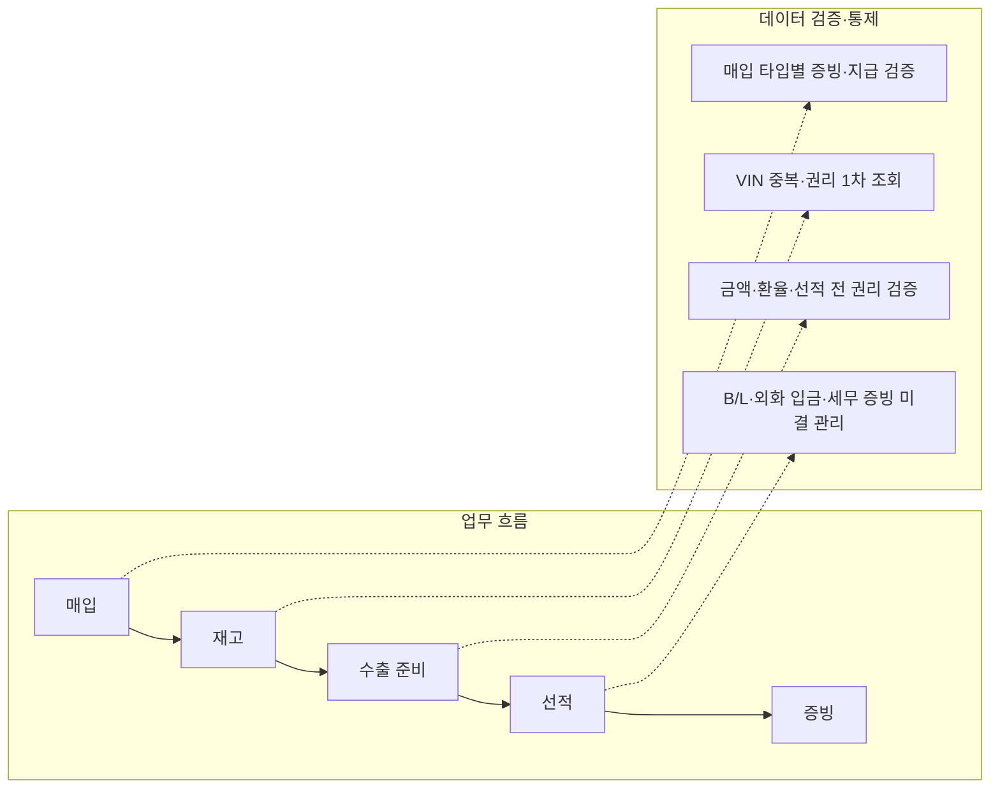

# 스마트 중고차 수출 ERP 시스템 업무 흐름 및 검증 로직

## 1. 화면 업무 흐름

차량 한 대를 하나의 업무 레코드로 보고, 화면에서는 업무 흐름을 `매입 → 재고 → 수출 준비 → 선적 → 증빙` 다섯 단계로 단순화한다. 수출 계약·신고 준비와 실제 선적 직전 통제를 분리해 선적 시점의 리스크를 명확히 보여준다.

> 파일 첨부는 서류 구비 완료를 뜻할 뿐, 단계 승인이나 자동 전이를 뜻하지 않는다. 담당자가 증빙을 첨부한 뒤 별도의 승인 요청을 보내고, 회계·영업 검토가 끝난 경우에만 다음 단계로 전환한다.

상세 8단계 흐름은 제출 문서에 노출하지 않고, 내부 도메인 참고용으로 [private/domain-workflow-8-stages.md](./private/domain-workflow-8-stages.md)에 보관한다.

## 2. 단계별 업무와 데이터 검증

| 단계 | 업무 흐름 블록 | 필요한 데이터 검증 | 실패 시 처리 |
| --- | --- | --- | --- |
| 매입 | 매입 타입과 지급 방식에 맞는 차량 등록 | VIN 형식·중복, 매입 상대방, 계약 금액, 타입별 필수 증빙 | 중복 VIN은 등록 차단. 필수값 누락은 저장 보류 |
| 재고 | 매입 확정 후 차량을 재고로 관리 | 지급액·계약액, 소유권, 권리 1차 조회, 매입 증빙 | 권리 이상은 하드 게이트. 증빙 지연은 미결 |
| 수출 준비 | 수출 계약과 신고·선적 준비 | 인보이스 외화 금액, 적용 환율, 환산액, 수출신고 정보 | 금액·환율 불일치는 회계팀 확인 필요로 전환 |
| 선적 | 선적 직전 최종 통제와 실행 | 수출신고 수리, 소유권, 권리 2차 조회, 선적 서류 | 권리 이상·수출신고 미수리·소유권 미확보는 선적 차단 |
| 증빙 | 선적 후 서류와 회계 확인 완료 | 수출신고필증, B/L, 외화 입금증명, 세무·환급 증빙, 금액 정합성 | 미결·담당자·기한 생성. 기한 초과 시 다음 거래 잠금 |

## 3. 검증 데이터 모델

### 매입 유형별 증빙 계산

매입 타입과 지급 방식은 증빙 체크리스트를 결정하는 핵심 입력값이다.

| 매입 타입 | 기본적으로 확인할 증빙 | 대표 검증 |
| --- | --- | --- |
| 딜러 | 매입 계약서, 사업자 정보, 거래명세서·계산서, 지급 증빙 | 사업자·계약 상대방·금액 일치 |
| 개인 | 매매 계약서, 판매자 신원·소유권 확인, 지급 증빙 | 등록 소유자·판매자·지급액 일치 |
| 경매 | 낙찰 확인서, 경매 거래 명세, 수수료 명세, 지급 증빙 | 낙찰 VIN·낙찰가·수수료·지급액 일치 |

지급 방식이 현금·계좌이체·계산서·경매 결제로 달라지면 추가 증빙과 검증 조건도 달라진다. 화면은 매입 타입을 바꿀 때 체크리스트를 다시 계산하고, 타입 변경 이력을 남긴다.

### 차량 식별

- `vehicle_id`: 시스템 내부 기본키
- `vin`: 외부 조회 키, 17자리, 활성 재고에서 중복 불가
- `purchase_type`: 딜러·개인·경매
- `sale_type`: 수출 고정값
- `status`: 업무 단계
- `risk_flags`: 압류·저당·도난·사고 등 위험 플래그

VIN은 조회 키로 사용하고 내부 식별자는 별도로 둔다. 종결된 차량은 같은 VIN이 다시 매입될 수 있으므로, 중복 검증은 활성 재고를 기준으로 한다.

### 금액과 환율

- 계약 금액
- 실제 지급액
- 인보이스 외화 금액
- 적용 환율
- 환율 기준일
- 환산 원화 금액
- 수출신고 금액
- 실제 외화 입금액

인보이스 금액과 수출신고 원화 금액은 환율 때문에 정상적으로 다를 수 있다. 따라서 금액 자체만 비교하지 않고, 적용 환율과 기준일을 함께 검증한다.

### 증빙

- 계약서
- 차량등록 관련 서류
- 매입 증빙
- 인보이스
- 수출신고필증
- B/L
- 외화 입금증명
- 세무·환급 관련 증빙

증빙은 거래 유형과 업무 단계에 따라 필수 여부와 제출 기한이 달라진다. 선적 후에만 생성 가능한 B/L이나 외화 입금증명은 선적 전 하드 게이트로 요구하지 않는다.

## 4. 하드 게이트와 미결 처리 기준

### 하드 게이트: 즉시 막아야 하는 조건

- 압류·저당·도난 등 권리 이상 확인
- 동일 VIN이 활성 재고에 이미 존재
- 수출신고가 수리되지 않음
- 매입 대금 지급이 완료되지 않음
- 소유권이 확보되지 않음
- 필수 식별 정보가 없어 거래 대상을 확정할 수 없음

차단된 버튼 옆에는 반드시 차단 사유와 해제 조건을 함께 표시한다.

### 미결: 진행하되 책임과 기한을 남기는 조건

- 선적 후 B/L 미첨부
- 선적 후 외화 입금증명 미첨부
- 세무·환급 증빙 지연
- 정상 범위 안에서 추가 확인이 필요한 환율 차이
- 담당자 확인이 필요한 금액 불일치

미결에는 `무엇이`, `어느 차량에서`, `왜`, `누가`, `언제까지`, `미처리 시 무엇이 잠기는지`를 저장한다. 기한을 넘기면 팀장 에스컬레이션과 다음 거래 잠금 규칙을 적용한다.

## 5. 단계별 성공 기준

### 매입 계약 단계

- VIN과 차량 기본 정보가 저장된다.
- 매입 유형에 맞는 필수 입력값이 계산된다.
- 중복 VIN을 등록할 수 없다.

### 매입 확정 단계

- 계약 금액과 지급액을 비교할 수 있다.
- 권리 1차 조회 결과와 증빙 상태를 확인할 수 있다.
- 차단 사유가 있으면 매입 확정 버튼이 잠긴다.

### 수출 계약 단계

- 인보이스 외화 금액과 적용 환율이 분리되어 보인다.
- 환산 원화 금액과 수출신고 기준 금액을 비교할 수 있다.
- 금액 불일치에는 담당자 검토 요청이 생성된다.

### 선적 단계

- 선적 직전 권리 재조회가 완료되어야 한다.
- 수출신고 수리와 소유권 확보를 확인해야 한다.
- 하드 게이트가 없을 때만 선적 버튼이 활성화된다.

### 증빙 완료·종결 단계

- 선적 후 생성되는 증빙은 기한과 담당자 기준으로 미결 관리된다.
- 필수 증빙과 금액 검증이 완료되어야 종결할 수 있다.
- 상태 변경 이력과 확인자가 남아야 한다.

## 6. 핵심 설계 문장

**선적은 허용하되 증빙은 미결로 남길 수 있다. 다만 권리·소유권·수출신고처럼 되돌릴 수 없는 위험은 버튼 단계에서 차단한다.**
